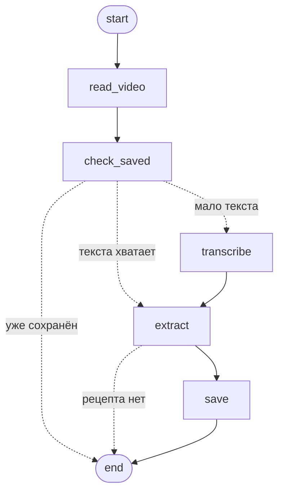

# recipe-bot-backend

Бэкенд чат-бота по рецептам: парсит рецепты из видео YouTube / TikTok / Instagram и отвечает на вопросы по ним.

**Стек:** Python 3.12, FastAPI, LangGraph, OpenRouter, Chroma, punq, aiogram.
**Архитектура:** чистая архитектура + CQRS + медиатор.

Фронтенд: [recipe-bot-frontend](https://github.com/teoofrast/recipe-bot-frontend)

## Запуск в Docker

Оба репозитория должны лежать рядом:

```
receipt/
├── recipe-bot-backend/
└── recipe-bot-frontend/
```

```bash
cp .env.example .env
docker compose up --build
```

- API: http://localhost:8000 (Swagger: http://localhost:8000/docs)
- Веб-чат: http://localhost:3000
- Telegram-бот (с карточки 10): `docker compose --profile bot up`

Если фронтенд лежит в другом месте — укажите путь в `FRONTEND_PATH` в `.env`.

## Тесты и проверки

```bash
docker compose run --rm api pytest
```

Локально без Docker (нужен [uv](https://docs.astral.sh/uv/)):

```bash
uv sync
uv run pytest
uv run ruff check . && uv run ruff format --check .
uv run lint-imports         # границы слоёв
uv run pre-commit install   # ruff + import-linter перед каждым коммитом
```

Обычный `pytest` (и CI) работает без сети. Интеграционные тесты ходят на настоящие платформы, их запускают отдельно:

```bash
uv run pytest -m integration
# TikTok и Instagram — по своим ссылкам (YouTube проверяется всегда):
TEST_TIKTOK_URL=https://www.tiktok.com/@.../video/... \
TEST_INSTAGRAM_URL=https://www.instagram.com/reel/.../ \
YTDLP_COOKIES_FILE=data/cookies/instagram.txt \
uv run pytest -m integration
```

## CLI

```bash
docker compose run --rm api receipt ping
docker compose run --rm api receipt ping-stream --count 3
docker compose run --rm api receipt video-info "https://youtu.be/jNQXAC9IVRw"
docker compose run --rm api receipt video-text "https://youtu.be/jNQXAC9IVRw"  # название, описание, субтитры
docker compose run --rm api receipt transcribe "https://youtu.be/jNQXAC9IVRw"  # речь из аудио через OpenRouter
docker compose run --rm api receipt extract "https://www.youtube.com/watch?v=QPy2sA8HC5U"  # рецепт (без сохранения)
docker compose run --rm api receipt extract "https://www.youtube.com/watch?v=QPy2sA8HC5U" --save
docker compose run --rm api receipt import "https://www.youtube.com/watch?v=QPy2sA8HC5U"  # полный импорт со статусами
docker compose run --rm api receipt list            # сохранённые рецепты
docker compose run --rm api receipt show <id>
docker compose run --rm api receipt delete <id>
docker compose run --rm api receipt search "что приготовить из курицы" [--max-minutes 30] [--tag ужин]
docker compose run --rm api receipt reindex         # пересобрать поиск из data/recipes
docker compose run --rm api receipt ask "что приготовить из курицы?"  # ответ потоком
docker compose run --rm -it api receipt chat        # диалог с памятью
```

## Импорт рецепта (граф LangGraph)

`ImportRecipe(url)` проводит ссылку через граф (`infrastructure/imports/langgraph_pipeline.py`);
схема — `uv run python scripts/import_graph.py`:



- **read_video** — название, описание, субтитры; **check_saved** — видео уже в коллекции? тогда сразу
  конец, без LLM; **transcribe** — речь, если текста мало; **extract** — LLM; **save** — файл + индекс.
- Статусы задачи (`GetImportStatus`): `queued → reading → [transcribing] → extracting → saving → done`,
  либо `no_recipe` / `failed` с понятной ошибкой. Задачи хранятся в памяти процесса.
- Одновременно идут `IMPORT_CONCURRENCY` (2) импорта, остальные ждут в `queued`.
- Повторы: чтение видео и скачивание аудио — до 3 раз при сбое связи (не при «приватное»/«удалено»);
  извлечение — ещё раз через 15 с, если все бесплатные модели упёрлись в лимиты.

## Ассистент

Агент LangGraph (`infrastructure/assistant/`): модель ↔ инструменты `search_recipes`, `get_recipe`,
`list_recipes` (обёртки над запросами приложения). Модель — `LLM_CHAT_MODELS` с запасными (карточка 4а).

- Ответ — поток событий `AskQuestion`: `token` (кусок текста), `tool` («ищу рецепты…»),
  `sources` (рецепты, которые агент открыл), `done` (какая модель ответила) или `error`.
- Отвечает только по сохранённым рецептам; поиск всегда что-то находит, поэтому агент сам решает,
  подходит ли кандидат, и честно говорит «такого рецепта нет».
- Память диалога — по `chat_id` (в памяти процесса); в модель уходят последние 20 сообщений.
- Не больше 12 шагов на ответ (защита от зацикливания на инструментах); если клиент ушёл —
  поток закрывается и агент останавливается.

## Хранение рецептов

Каждый рецепт — файл `data/recipes/<id>.json`: сам рецепт, источник (ссылка, платформа, ID видео,
автор) и исходный текст (описание, субтитры, распознанная речь), чтобы рецепт можно было переизвлечь.
Одно видео сохраняется один раз: дубли ищутся по платформе и ID видео, так что `youtu.be/x` и
`youtube.com/watch?v=x` — одно и то же.

Контейнер работает не от root, а от пользователя с UID 1000, поэтому файлы в `data/` — ваши.
Если ваш UID другой (`id -u`), соберите образ с `docker compose build --build-arg APP_UID=$(id -u)`.

## Поиск по рецептам

Поиск по смыслу: Chroma (сервис в docker-compose) + эмбеддинги OpenRouter `intfloat/multilingual-e5-large`
(выбрана пробой на русских рецептах: 7/7 запросов, включая английский к русским рецептам; ~$0.01 за 1M токенов).

- Один рецепт — один документ: название, кухня, теги, ингредиенты, шаги.
- Фильтры: `--max-minutes` (рецепты с неизвестным временем не проходят), `--tag`, `--cuisine`.
- Индекс — производное от `data/recipes`: при сохранении и удалении он обновляется, а если Chroma
  была недоступна, рецепт всё равно сохраняется/удаляется, и `receipt reindex` всё догоняет.
- `SEARCH_MIN_SCORE` (0.78) отсекает бессмыслицу: у E5 всё русское похоже на 0.7–0.9, подходящие
  рецепты набирали от 0.795, «как поменять колесо» — 0.75. Тоньше судит ассистент (карточка 9).
- Локально (`uv run`) Chroma доступна на `localhost:8001`: `docker compose up -d chroma`.

## Распознавание речи

Через OpenRouter (`/audio/transcriptions`). Нужен `OPENROUTER_API_KEY` в `.env` и **кредиты на балансе**:
бесплатных моделей распознавания нет.

Сравнение на реальных роликах (3 минуты русской речи; Reels с музыкой без речи):

| Модель | $ / мин | 3 мин речи | Речь | Музыка без речи |
|---|---|---|---|---|
| `openai/gpt-4o-mini-transcribe` (основная) | 0.0018 | 4.8 с | отлично | пусто ✅ |
| `openai/whisper-large-v3-turbo` (запасная) | 0.0002 | 4.4 с | хорошо, опечатки | «Субтитры сделал DimaTorzok» |
| `openai/whisper-large-v3` | 0.0015 | 14.3 с | хорошо | галлюцинации |
| `openai/gpt-4o-transcribe` | 0.0034 | 8.6 с | отлично | фраза на венгерском |

Известные галлюцинации Whisper («Субтитры сделал…», «Продолжение следует…») вычищаются из текста.

Модели пробуются по очереди (`STT_MODELS`, через запятую): таймаут, лимит или ошибка провайдера —
переход к следующей; неверный ключ или пустой баланс — сразу понятная ошибка. Перед отправкой
ffmpeg оставляет от видео только речь: mono, 16 кГц, mp3 32 кбит/с (~240 КБ на минуту).

## Языковые модели (LLM)

Бесплатные модели OpenRouter (`:free`), у каждой задачи свой список запасных: `LLM_EXTRACT_MODELS`
(извлечение рецепта: нужен JSON по схеме) и `LLM_CHAT_MODELS` (агент: нужен вызов инструментов).
Модели по умолчанию выбраны пробой на русском тексте рецепта — см. `bootstrap/settings.py`.

- Переход к следующей модели: таймаут, 429 (общие лимиты бесплатных моделей срабатывают часто),
  5xx, модель удалена или не поддерживает запрос, невалидный JSON.
- У каждой модели жёсткий дедлайн: OpenRouter держит соединение, пока модель думает, и обычный
  таймаут HTTP не срабатывает. Извлечение — `LLM_EXTRACT_TIMEOUT_SECONDS` (120 с: бесплатные модели
  пишут JSON рецепта на 20 ингредиентов 60–70 с, импорт идёт в фоне), чат — `LLM_CHAT_TIMEOUT_SECONDS` (40 с).
- Стриминг: переход возможен только до первого чанка; сбой посреди ответа — ошибка.
- Неверный ключ (401) или пустой баланс (402) — сразу понятная ошибка, без перебора.
- В логах видно, какая модель упала и какая ответила.
- Лимиты бесплатных моделей: 20 запросов в минуту; в день — 50, а если куплено от $10 кредитов, то 1000.

## Instagram и cookies

Instagram часто не отдаёт видео без входа в аккаунт — тогда `video-info` скажет «нужны cookies».

1. Войдите в Instagram в браузере и выгрузите cookies в формате Netscape
   (например, расширением «Get cookies.txt LOCALLY») в `data/cookies/instagram.txt`.
2. В `.env`: `YTDLP_COOKIES_FILE=data/cookies/instagram.txt` — относительный путь работает и локально,
   и в контейнере (рабочая папка там `/app`, а `data/` подключена в `/app/data`).

Cookies — это доступ к аккаунту: `data/` и `cookies*.txt` в `.gitignore`, не коммитьте их.
Лучше завести для бота отдельный аккаунт Instagram.

## Архитектура

```
src/receipt/
├── domain/          # сущности и правила, без внешних зависимостей
├── application/     # порты, команды/запросы и их обработчики, медиатор
├── infrastructure/  # адаптеры: yt-dlp, Whisper, OpenRouter, Chroma, LangGraph
├── presentation/    # api (FastAPI), bot (Telegram), cli
└── bootstrap/       # composition root: контейнер punq, настройки, точки входа
```

Зависимости направлены внутрь: `bootstrap → presentation | infrastructure → application → domain`.
`presentation` и `infrastructure` друг о друге не знают и встречаются только в `bootstrap`.
`domain` и `application` не импортируют фреймворки. Всё это проверяет `lint-imports`.

**Как проходит запрос.** Presentation создаёт команду или запрос и отдаёт медиатору:

```python
# Command / Query -> результат
pong = await mediator.send(Ping())

# StreamQuery -> поток чанков
async for chunk in mediator.stream(PingStream(count=3)):
    ...
```

Медиатор находит обработчик по типу запроса (`HANDLERS` в `bootstrap/container.py`), берёт его из punq
вместе с зависимостями и пропускает вызов через behaviors: `LoggingBehavior` (время, начало и конец потока)
и `ErrorBehavior` (`DomainError` и `ApplicationError` пропускает, остальное логирует и оборачивает в `UnexpectedError`).

**Как добавить use case:**

1. Запрос и обработчик в `application/` — frozen dataclass от `Command[T]`, `Query[T]` или `StreamQuery[T]`.
2. Нужен внешний сервис — порт (`Protocol`) в `application/ports/`, адаптер в `infrastructure/`.
3. Регистрация в `bootstrap/container.py`: запрос → обработчик в `HANDLERS`, порт → адаптер.
4. Эндпоинт или команда CLI в `presentation/`, которые зовут `mediator.send` / `mediator.stream`.

**Тесты** берут ту же сборку контейнера и перерегистрируют внешние адаптеры фейками (`tests/conftest.py`):
в punq побеждает последняя регистрация.
